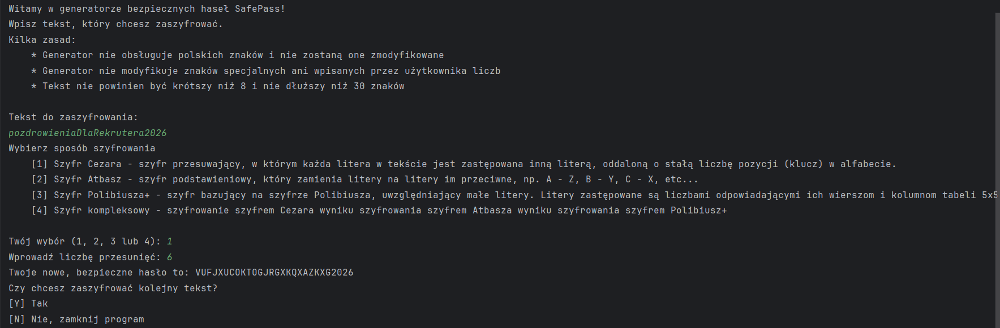
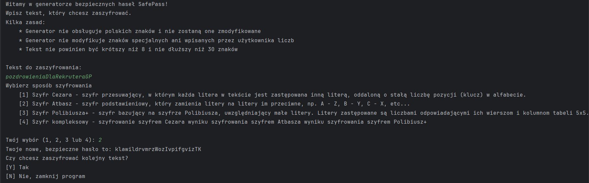
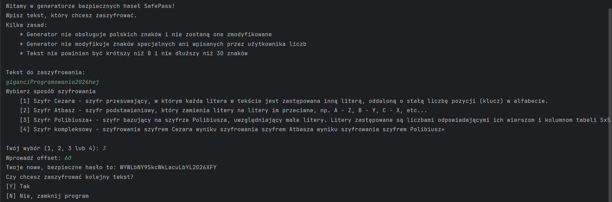
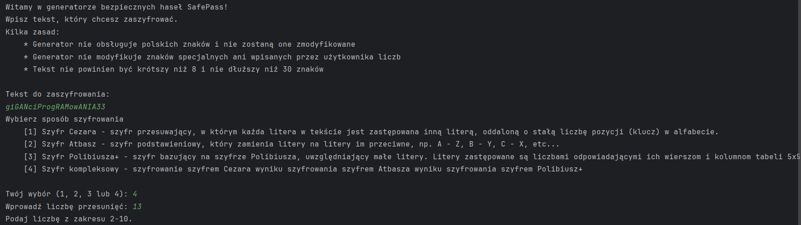
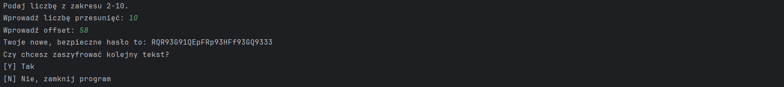

# SafePass

Projekt edukacyjny: konsolowa aplikacja w Javie, która szyfruje tekst podany przez użytkownika klasycznymi szyframi oraz własną modyfikacją szyfru Polibiusza.

## Dostępne szyfry

- **Szyfr Cezara** - każda litera jest zastępowana literą oddaloną o stałą liczbę pozycji (klucz) w alfabecie.
- **Szyfr Atbasz** - zamienia litery na przeciwne w alfabecie, np. A - Z, B - Y, C - X.
- **Szyfr Polibiusza+** - modyfikacja szyfru Polibiusza uwzględniająca małe litery. Litery zamieniane są na liczby wynikające z ich położenia w tabeli 5x5, a następnie dodawany jest offset podany przez użytkownika, dzięki któremu część liczb zamienia się na litery.
- **Szyfr kompleksowy** - kolejno: Polibiusz+, Atbasz i Cezar.

## Uruchomienie

Wymagana Java 15 lub nowsza.

```bash
javac src/*.java
java -cp src Main
```

## Przykłady

### Szyfr Cezara


### Szyfr Atbasz


### Szyfr Polibiusza+


### Szyfr kompleksowy

